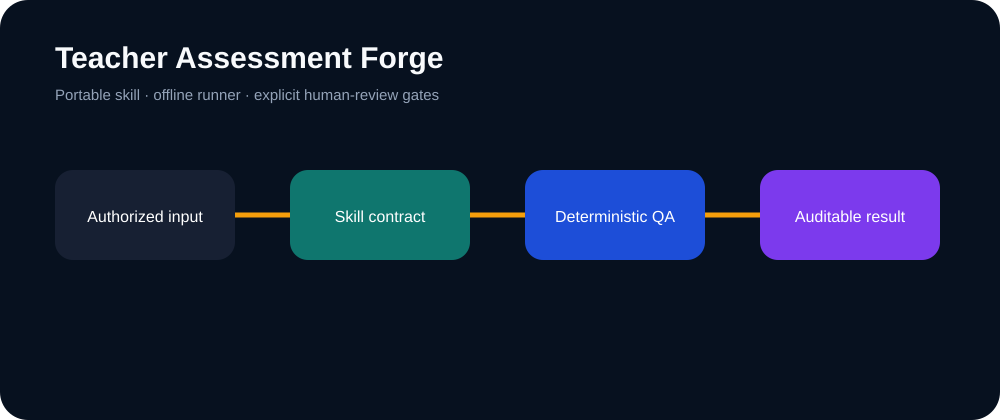

# Teacher Assessment Forge



Create balanced assessment blueprints from learning objectives, difficulty targets and marking constraints.

Portable skill for Claude Code, Codex, ChatGPT, Claude, Gemini, Grok and custom MCP/agent runtimes. It combines concise agent instructions with an offline deterministic runner.

## Quick start

```bash
python skill/scripts/run.py examples/input.json
pytest -q
```

## Install

Copy `skill/` into your agent project or skills directory. For Claude Code or Gemini/Grok projects, reference `skill/SKILL.md` as project instructions and expose the runner as a local tool. No API key or third-party dependency is required.

## Responsible use

Use only authorized exports, official APIs or user-supplied data. This project does not bypass login, anti-bot controls, rate limits or privacy settings. See [Guardrails](docs/GUARDRAILS.md).

## Repository map

- `skill/` — installable, token-efficient capability
- `examples/` — reproducible demonstration
- `tests/` — executable contract test
- `docs/` — installation and guardrails
